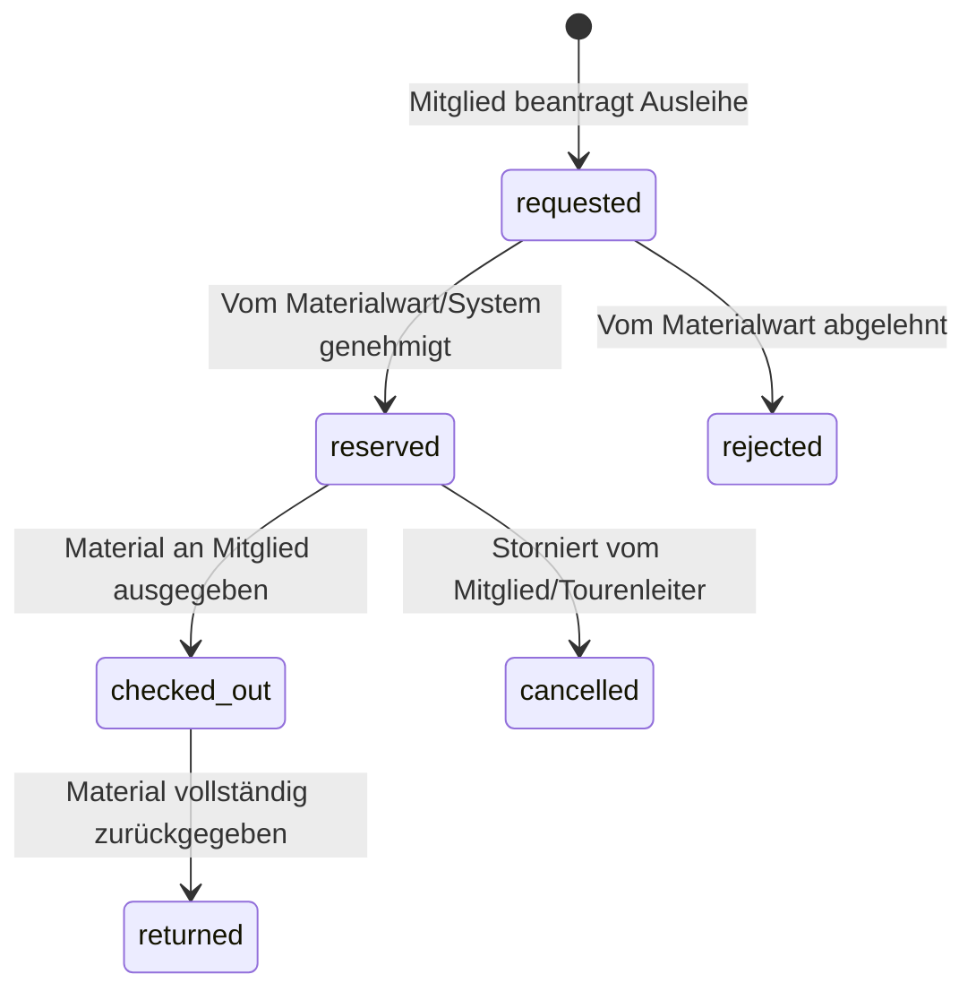

# Material- & Ausrüstungsverleih (`material-verleih.md`)

Die DAV Sektion Pfarrkirchen stellt ihren Mitgliedern Bergsportausrüstung (z.B. LVS-Sets, Steigeisen, Eispickel, Klettersteigsets, Helme) zur Verfügung. Das Material-Modul regelt den Inventarbestand, Reservierungen und Ausgaben.

---

## 📦 Inventarstruktur & Kategorien

Die Ausrüstung wird im kanonischen, normalisierten Modell verwaltet:

1. **`material_types`**: Bezeichnung und Kategorie des Materials.
2. **`material_inventory`**: Größen, Gesamtbestand und verfügbarer Bestand je
   Materialtyp.
3. **`material_pricing`**: Preisstaffeln je Materialtyp.

4. **`material_reservations` (Reservierungen)**:
   * `material_inventory_id`: Referenz auf Bestand und Größe.
   * `user_id`: Ausleihendes Mitglied.
   * `tour_id`: (Optional) Anbindung an eine Sektionstour.
   * `quantity`: Positive reservierte Stückzahl.
   * `status`: Status der Reservierung.
   * `loan_date` / `return_date`: Verleihzeitraum.

Die früheren Tabellen `materials` und `tour_materials` werden in einer
additiven Migration in das kanonische Modell überführt und anschließend nicht
mehr für Browser-Zugriffe freigegeben.

---

## 🔄 Status-State Machine für Buchungen (`booking_status`)



---

## 🔒 Atomare Bestandsprüfung (`apply_material_reservation_transition_atomic`)

Um Überbuchungen bei gleichzeitigem Zugriff zu verhindern, erfolgt die Buchungsänderung über eine atomare Stored Procedure:

```sql
-- Verkürztes Schema des Bestands-Check Locks in Postgres
SELECT quantity_total, quantity_available
FROM material_inventory
WHERE id = p_material_id 
FOR UPDATE;
```

* **Bestandsschutz**: Bei jeder Zuweisung wird geprüft, ob `available_quantity >= quantity` gilt. Falls nicht, bricht die Transaktion mit dem Fehlercode `inventory_exceeded` ab.
* **Automatische Freigabe**: Bei Rückgabe (`returned`) oder Stornierung (`cancelled`) wird `available_quantity` atomar wieder erhöht.

---

## 👨‍💼 Materialwart-Dashboard (`/admin/material`)

Der Sektions-Materialwart verfügt über ein eigenes Verwaltungsinterface:
* **Offene Anträge**: Genehmigung oder Ablehnung manuell quittierungspflichtiger Gegenstände.
* **Ausgabe & Rücknahme**: Erfassung von Warenausgängen und Zustandskontrollen.
* **Inventur & Wartung**: Sperrung defekter Gegenstände für Reparaturen.

---
*Zurück zur [Wiki-Übersicht](file:///c:/Users/paulw/WebstormProjects/davpan/docs/README.md)*
